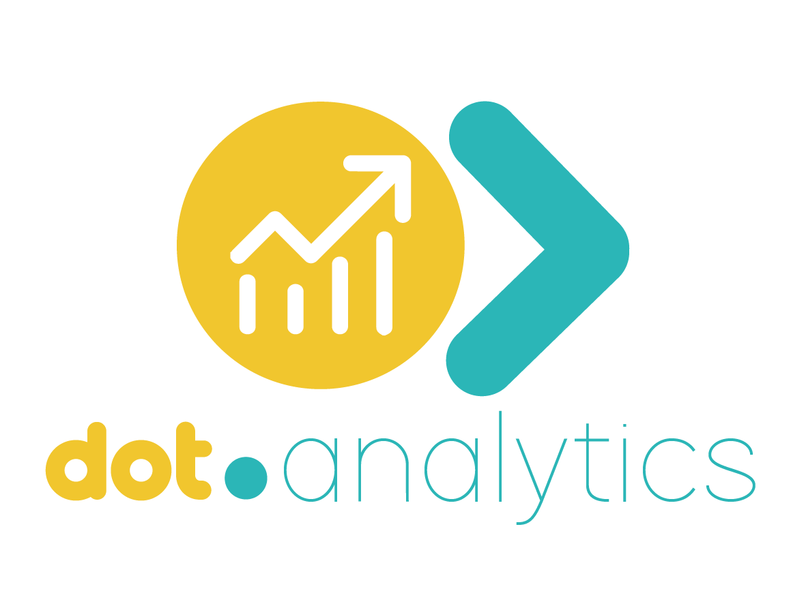

<div align="center">



<h1>Dot.Analytics</h1>

<p>The intelligence layer of the Dot ecosystem — not a BI tool, not a dashboard platform, but the <strong>central nervous system</strong> that continuously consumes data from every Dot platform, understands the relationships between them, and produces intelligence for the entire ecosystem.</p>

[](https://php.net)
[](https://laravel.com)
[](https://livewire.laravel.com)
[](https://postgresql.org)
[](https://anthropic.com)
[](LICENSE)

</div>

---

## What it is

Traditional BI tools (Power BI, Tableau, Looker, Zoho Analytics) are excellent at visualising data that users prepare for them. Dot.Analytics does something fundamentally different — it **understands relationships across the entire Dot ecosystem**, continuously generates insights, predicts outcomes, recommends actions, and feeds intelligence back into every platform.

Every Dot platform **contributes knowledge to** Dot.Analytics. Every Dot platform **benefits from** it. As organisations adopt more Dot products, the intelligence becomes richer, creating a network effect that is extremely difficult to replicate externally.

---

## Ecosystem Architecture

```
                    Dot.Analytics
                  (Intelligence Core)

    Dot.Farms    Dot.Emall    Dot.Billing   Dot.Ehail
    Dot.HR       Dot.Pulse    Dot.Notify    Dot.Mines
    Dot.Agents   Dot.Finance  Dot.Plug      Dot.Central
    Dot.Projects Dot.Tasks    Dot.Auction   Dot.Charts
    Dot.Design   Dot.Dopemine Dot.Memory

              + Third-party systems
```

Every platform contributes intelligence. Every platform receives intelligence. No platform is "above" the others — Dot.Analytics is the layer that connects them all. (See the full, current roster in Dot.Brain's [`brain.platforms.md`](https://github.com/sakhilebhayi/Dot.Brain/blob/main/brain.platforms.md) registry.)

---

## The Intelligence Engines

Each engine consumes data from several Dot platforms and produces a holistic view rather than isolated reports. The platforms below are the **real** Dot platforms that report metrics today (the keys of `config/ecosystem.php`); the earlier roster (Dot.Fleet, Dot.CRM, Dot.Hear, Dot.Vault...) never existed as platforms and has been removed from `IntelligenceEngineService`. An engine that no real platform can feed yet is **dormant**: it never runs and nothing is made up for it.

| Engine | Fed by |
|---|---|
| Data Intelligence | Dot.Notify |
| Business Intelligence | Dot.Auction, Dot.HR, Dot.Billing, Dot.Emall |
| Operational Intelligence | Dot.Tasks, Dot.Ehail, Dot.HR, Dot.Farms, Dot.Tutor, Dot.Notify, Dot.Design |
| Financial Intelligence | Dot.Auction, Dot.Billing, Dot.Emall |
| People Intelligence | Dot.HR, Dot.Tasks, Dot.Tutor |
| Customer Intelligence | Dot.Ehail, Dot.Billing, Dot.Emall, Dot.Pulse |
| Community Intelligence | Dot.Pulse |
| Predictive Intelligence | Dot.Tasks, Dot.Auction, Dot.Ehail, Dot.Farms, Dot.Billing, Dot.Emall |
| Decision Intelligence | Dot.Tasks, Dot.Billing, Dot.Emall |
| Risk Intelligence | Dot.HR, Dot.Billing, Dot.Pulse, Dot.Notify |
| Agriculture Intelligence | Dot.Farms |
| Retail Intelligence | Dot.Auction, Dot.Emall |
| Prescriptive Intelligence | Dot.Tasks, Dot.HR, Dot.Billing, Dot.Emall |
| Document, AI, Security, Asset, Mining, Construction, Manufacturing, Healthcare, Compliance | dormant: no real platform reports for them yet |

---

## The real data path

```
platform --signed daily snapshot--> POST /api/v1/ingest/{platform}
   -> analytics_snapshots     validated against config/metrics.php, stored once (idempotent)
   -> computed_metrics        value, previous value, delta, delta %, per metric per day (hourly + after each snapshot)
   -> anomaly alerts          median-absolute-deviation, only with >= 7 prior daily points, once per metric per day
   -> dashboard tiles + trends, saved dashboards, briefings, Business DNA, AI engines
```

* The contract is [`docs/metrics-contract.md`](docs/metrics-contract.md); the catalogue is `config/metrics.php`. Each platform has a short list of headline numbers (tasks open and overdue, billing MRR and overdue amount, ...). Unknown keys are dropped, the wrong kind of value is a 422, money is whole cents plus an ISO currency, a replay returns the original.
* **Nothing is invented.** A metric nobody reported is "no data yet", never `0`. A value older than two daily periods is shown **stale**. Demo numbers exist only through the local-only `DemoMetricsSeeder` and are labelled DEMO DATA wherever they appear.
* Briefings, Business DNA and the AI engines read the same real snapshots and computed metrics. With no data there is no briefing and no Business DNA profile ("no data yet"), and with no AI provider nothing is generated.
* This repo is the receiving side. The publishing side (each platform posting its snapshot) is a separate piece of work in each platform.

### Running it: cron and queue

| Need | Why |
|---|---|
| Laravel scheduler every minute (`* * * * * php artisan schedule:run`) | hourly `analytics:compute-metrics` (compute + anomaly check), every-minute `analytics:run-scheduled-reports` (saved reports with a cron expression, read in the team timezone, run history kept; nothing is emailed), the 6-hourly engine run, briefings and the nightly Business DNA |
| A queue worker | `ComputeMetricsJob` refreshes a team's tiles right after a snapshot arrives; without a worker the hourly run still computes everything |

### Not wired

Data connectors (REST, database, file), data pipelines, the AI-to-SQL service and the currency service exist in the codebase, but no route or screen creates a connector, so they play no part in the data path. They are left in place, untouched and untested end to end; do not assume they work.

---

## Cross-Platform Intelligence (The Real Superpower)

The defining capability of Dot.Analytics is insight that **no single platform can produce alone**.

**Illustration (what this is for, not output):**
> Overdue invoices rose (Dot.Billing) in the same week orders fell (Dot.Emall), leave requests piled up unapproved (Dot.HR) and failed notifications climbed (Dot.Notify).

No individual platform sees this. Only Dot.Analytics does, and only once those platforms are connected and sending their numbers; an engine only ever reasons about snapshots that actually arrived.

---

## Business DNA Profile

Every organisation on the Dot ecosystem has a unique operational fingerprint. Dot.Analytics continuously builds a **Business DNA Model** by learning:

- How the company operates day-to-day
- Seasonal trends and demand cycles
- Decision-making patterns
- Team performance profiles
- Customer behaviour segments
- Financial cycles and cash flow patterns
- Operational bottlenecks
- Risk tolerance
- Growth opportunities

This evolving model becomes increasingly accurate over time, allowing intelligence engines to produce recommendations tailored to that specific organisation rather than relying on generic analytics.

---

## Universal Intelligence Graph

Rather than isolated databases, Dot.Analytics maintains an internal knowledge graph connecting every entity across the ecosystem:

```
Customer → Orders → Invoices → Payments → Support Tickets
       → Equipment → Operators → Maintenance → Fuel
       → Community Posts → AI Conversations → Contracts
       → Projects → Inventory → Suppliers
```

This graph enables AI to answer questions no traditional BI system can answer — tracing causal chains across the entire ecosystem.

---

## Features

- **Platform Metrics** — KPI tiles (value, change vs the previous report, sparkline) and a trend for every connected platform; stale and no-data states shown as such
- **Dashboard Builder** — saved dashboards of KPI and trend widgets over those real metrics
- **Metric anomaly alerts** — flagged only with enough history, with their provenance
- **Ecosystem Map** — the 11 Dot platforms that report metrics, click-to-connect, active engine coverage
- **Universal Intelligence Query** — ask any natural-language question, answered across all platforms
- **Cross-Platform Insights** — automatically discovered multi-platform correlations and causal chains
- **Business DNA Panel** — evolving organisational fingerprint with confidence scoring
- **Intelligence Engines** — 22 defined, 13 able to run on today's real platforms (see above)
- **Metric catalogue** — 37 metrics across 11 platforms (`config/metrics.php`), the snapshot contract
- **Intelligence Graph** — `IntelligenceNode` / `IntelligenceEdge` model for entity relationship mapping
- **Predictive Alerts** — cross-platform signals surfaced as severity-ranked alerts
- **AI Recommendations** — actionable insights with cross-platform rationale
- **Ecosystem SSO** — authenticate from InfoDot with a single click

---

## Domain Model

```
Team
 ├── DataSource (connected Dot platforms)
 ├── AnalyticsSnapshot (validated, signed daily snapshots)
 ├── CrossPlatformInsight (multi-platform discoveries)
 ├── IntelligenceEngineRun (engine execution audit)
 ├── IntelligenceNode / IntelligenceEdge (knowledge graph)
 ├── BusinessDnaProfile (evolving organisational fingerprint)
 ├── MetricDefinition → ComputedMetric (one row per metric per day, from real snapshots)
 ├── AnalyticsAlert (cross-platform signals)
 ├── Recommendation (AI-generated actions)
 └── AnalyticsDashboard → DashboardWidget
```

---

## Roles

Access follows the team (company) role. InfoDot is the source of truth and the role is re-applied at every sign-in.

| InfoDot role | Dot.Analytics role | Can |
|---|---|---|
| owner, admin | admin (owner for the creator) | manage the layer: connect and disconnect platforms, rotate webhook secrets, run engines, generate briefings, recommendations and Business DNA, use the AI SQL endpoints, review insights, resolve alerts, action recommendations, create and delete saved reports |
| editor | editor | read everything, plus work inside the layer: run saved reports, arrange dashboards, ask the Intelligence box (an AI call) |
| viewer | viewer | read only: insights, alerts, recommendations, reports, dashboards and the platform list. No write, no AI call (the Intelligence box is replaced by a note), no control that would answer 403 |
| anything else | viewer | an unrecognised InfoDot role gets the least powerful role, never editor |

Webhook secrets are shown once, to the admin who issues them, and are never serialised or rendered for anyone else. Feature flags are global and reserved for platform operators; no team role grants that. The gates are in `AppServiceProvider`; `ask-intelligence`, `edit-dashboards` and `run-reports` are the three that separate an editor from a viewer. The role matrix is in `tests/Feature/Roles/ViewerRoleMatrixTest.php`.

## Tech Stack

| Layer | Technology |
|---|---|
| Framework | Laravel 12 + PHP 8.4 |
| Frontend | Livewire 3 + Alpine.js + Tailwind CSS |
| Auth | Jetstream 5 + Sanctum (ecosystem SSO) |
| Database | PostgreSQL 16 (shared infodot instance) |
| AI | Anthropic Claude Sonnet (nothing generated when no key is configured) |

---

## Quick Start

```bash
git clone https://github.com/sakhileb/Dot.Analytics.git && cd Dot.Analytics
composer install && npm install
cp .env.example .env && php artisan key:generate
php artisan migrate --seed
npm run dev & php artisan serve
```

Set `ANTHROPIC_API_KEY` in `.env` to enable live AI intelligence. Without it the AI features say so and produce nothing: there is no canned or rule-based stand-in text. Metrics, trends and anomaly alerts need no AI.

To see the metric screens with data in local development, `php artisan db:seed --class=DemoMetricsSeeder` posts 30 days of clearly labelled DEMO DATA through the real ingest path (refused outside local/testing, never run by `db:seed`).

---

## Part of the Dot Ecosystem

Dot.Analytics connects to [InfoDot](https://github.com/sakhileb/InfoDot) — the central hub. Log in to InfoDot once and navigate here without re-authenticating via `/auth/ecosystem`.

---

MIT — © SK Digital / BluPin Incorporated
